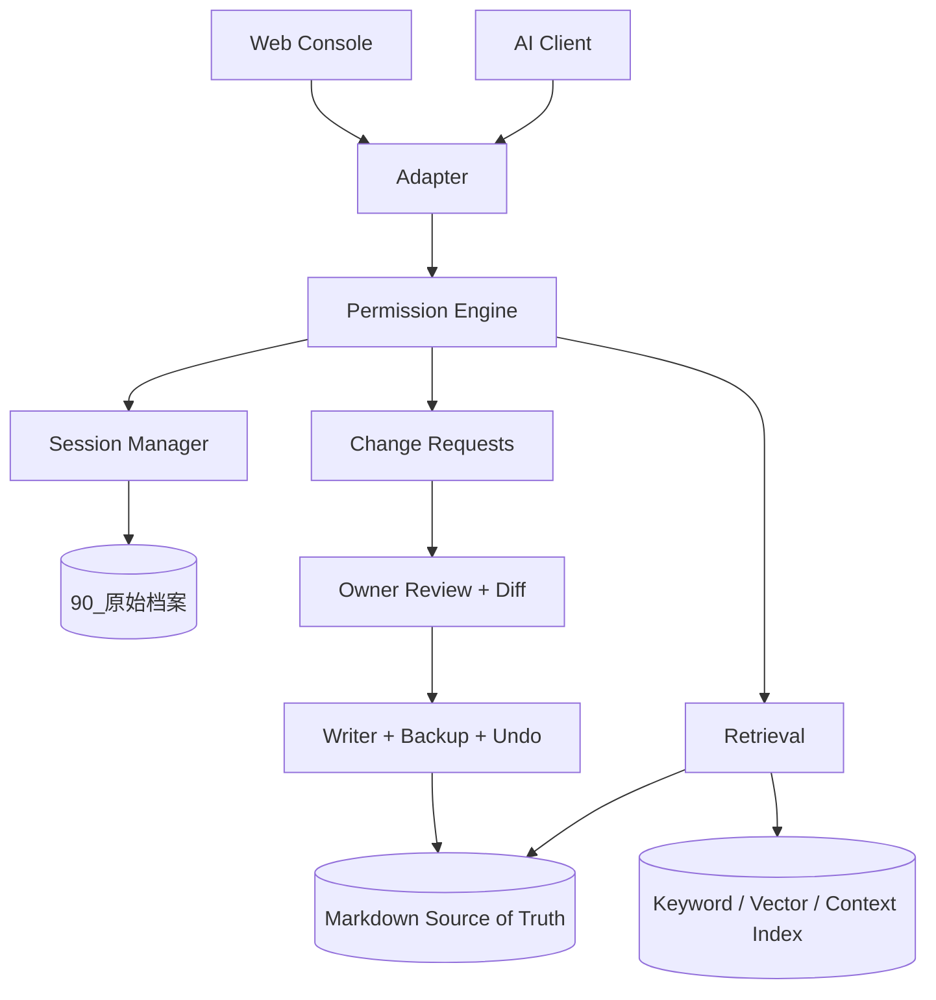

# 架构

## 定位

界渡位于本地私人知识域与外部 AI 客户端之间。它管理资料、来源、权限和整理流程，并通过可选的本机推理服务或外部 API 支持管家。模型的判断与确定性的存储、授权和写入规则分开。

## 分层

1. **Adapter**：stdio MCP、localhost Bridge、Web Console。
2. **Permission Engine**：全局访问、客户端、工具三级判定。
3. **Core Services**：检索、上下文、项目状态、Session、审计、候选和 Writer。
4. **Storage**：Owner Markdown、`90_原始档案`、LanceDB 与本地运行状态。

## 真相源与派生数据

- Markdown 与 `90_原始档案` 是 Owner 资产。
- LanceDB、Chunk、Vector、Context Window、UMAP 和缓存均为派生数据。
- Session 原文归档是 append-only；摘要或 Candidate 不能替换原文。
- Core Bootstrap 是配置的核心背景文件的派生读取结果，不反向覆盖母档。

## 生命周期

`bridge_launcher` 负责 Console、Watcher、PID、健康检查和防重复实例。Console 固定绑定 `127.0.0.1`；MCP 默认 stdio，也可配置 localhost HTTP。公网、远程 MCP 和云同步默认禁止。

## 主要模块

- `core.py`：索引、搜索、地图和基础数据访问。
- `ai_access.py`：不依赖向量的只读 Markdown 访问。
- `mcp_server.py`：MCP 工具与权限适配。
- `chatgpt_adapter.py`：通用 localhost Bridge Context 兼容层。
- `session_manager.py` / `session_archive.py`：会话状态与 L0 归档。
- `memory_pipeline.py` / `production_writer.py`：Candidate、Diff、写入与 Undo。
- `web.py` + `static/`：本地 Console。
